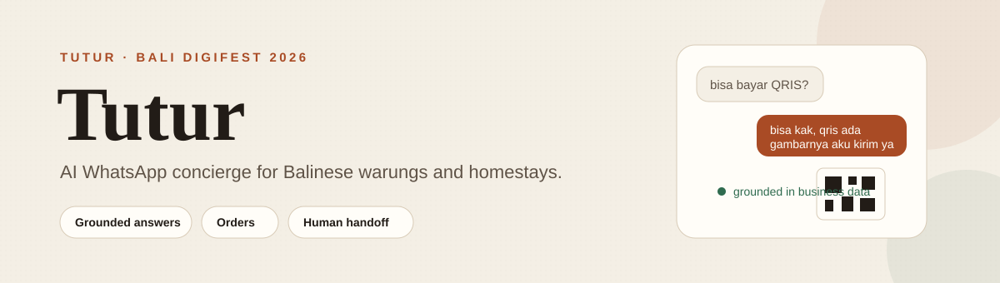

<div align="center">
  

  <p>
    <a href="https://tuturku.biz.id/coba"><strong>Demo langsung</strong></a> ·
    <a href="README.md">English</a> ·
    <a href="docs/ARCHITECTURE.md">Arsitektur</a> ·
    <a href="docs/DEPLOY.md">Deploy</a>
  </p>
</div>

Tutur adalah asisten WhatsApp untuk warung dan homestay di Bali. Tutur menjawab pertanyaan pelanggan dari data usaha sendiri, mencatat pesanan ke dashboard, dan menahan pesan booking, alergi, komplain, atau pesanan supaya pemilik yang memutuskan.

Dibuat untuk **Bali DigiFest 2026, AI Web Innovation Challenge**, kategori Mahasiswa/Umum. Versi lomba ditandai dengan tag `v1.0-submission`.

## Masalah yang diselesaikan

Pemilik warung menerima chat dalam Bahasa Indonesia dan Inggris saat sedang memasak, mengantar, atau tidur. Balasan cepat tidak bisa menjawab "ada menu vegan" atau "bisa bayar QRIS". Chatbot umum mengarang harga dan mengonfirmasi meja yang tidak tersedia.

Tutur menjawab hanya dari data usaha. Kalau datanya tidak ada, Tutur bilang akan cek ke pemilik.

## Fitur utama

| Fitur | Perilaku |
|---|---|
| Jawaban berdasar data | Harga, jam buka, menu, lokasi, dan pembayaran diambil dari knowledge base pemilik. Fakta yang tidak ada menjadi draft, bukan tebakan. |
| Gaya bicara pemilik | Gaya pesan dipelajari dari panjang pesan, huruf besar-kecil, slang, dan emoji pada ekspor chat. |
| Pencatatan pesanan | Nama pemesan, item, dan total masuk ke `/pesanan`. Pemilik bisa menandai selesai atau batal. |
| Pembayaran | Pemilik mengatur tunai, QRIS, dan transfer bank. Pertanyaan QRIS mengirim gambar QRIS. Pertanyaan transfer mengirim info rekening. |
| Eskalasi manusia | Booking, pesanan, komplain, dan alergi menjadi draft. Spam diabaikan. Nomor VIP tidak dibalas otomatis. |
| Jejak keputusan | Coba Chat menampilkan keputusan policy, intent, keyakinan, sumber data, model, dan waktu jawab. |
| Akun terpisah | Login email, Google, dan Facebook. Profil usaha, katalog, knowledge, dan pesanan terpisah per akun. |

## Cara kerja

```text
Pesan pelanggan
      |
      v
Cek intent dan risiko  ->  spam: abaikan
      |
      v
Ambil knowledge dari SQLite
      |
      v
Generate jawaban dengan AI
      |
      v
Policy: kirim otomatis / draft / abaikan
      |
      +--> Balasan WhatsApp, gambar QRIS, catatan pesanan
      |
      +--> Antrean draft dan jejak keputusan di dashboard
```

Fungsi `generateReply` dan `decide` yang sama dipakai jalur WhatsApp dan Coba Chat.

## Evaluasi

`npm run eval` menjalankan 28 pertanyaan dua kali: tanpa knowledge base dan dengan retrieval.

| Metrik | Tanpa knowledge base | Tutur |
|---|---:|---:|
| Jawaban benar | 13/28 | 28/28 |
| Harga karangan pada fakta yang tidak ada | tidak diukur | 0 |

Hasil ini berasal dari test set bawaan dan pengecekan kata kunci otomatis, bukan penilaian manusia. Metode dan batasannya ada di [docs/eval-results.md](docs/eval-results.md).

## Jalankan lokal

```bash
git clone https://github.com/CheztaGenZ/Tutur-Umkm-Assistant.git
cd Tutur-Umkm-Assistant
cp .env.example .env
# isi AI_API_KEY dan AI_MODEL
npm install
npm start
```

Buka `http://localhost:3000` untuk dashboard dan `http://localhost:3000/coba` untuk demo tanpa login.

Mode demo:

```bash
DEMO_MODE=1 ADMIN_TOKEN=ubah-ini npm start
```

Di Windows, gunakan `copy .env.example .env`.

## Tes

```bash
npm test
```

Suite mencakup handler, status, setting, keamanan, grounding prompt, policy, public API, demo seed, auth, produk, dan isolasi akun. Tes memakai database sementara dan klien WhatsApp palsu, jadi tidak butuh akun WhatsApp atau API key asli.

Pemeriksaan tambahan:

```bash
node scripts/security.test.mjs        # 42 pemeriksaan keamanan
node scripts/prompt-grounding.test.mjs
npm run eval                          # butuh API key AI
```

## Batasan

- Transport WhatsApp dimatikan saat penjurian untuk menghindari risiko akun. Coba Chat memakai kode AI dan policy yang sama.
- Riwayat chat dan pelatihan gaya masih satu workspace. Profil usaha, katalog, knowledge, dan pesanan sudah terpisah per akun.
- Retrieval memakai kata kunci. Katalog yang jauh lebih besar butuh embeddings atau search index.
- SQLite cocok untuk satu penyewa. SaaS multi-tenant butuh Postgres.
- Evaluasi 28 pertanyaan dengan skor kata kunci adalah sinyal, bukan benchmark.
- Belum ada pilot pelanggan nyata. Angka dampak di Coba Chat menggabungkan simulasi 30 hari dan sesi live.

## Lisensi

MIT. Lihat [LICENSE](LICENSE).

Dokumen lengkap dalam Bahasa Inggris ada di [README.md](README.md).

