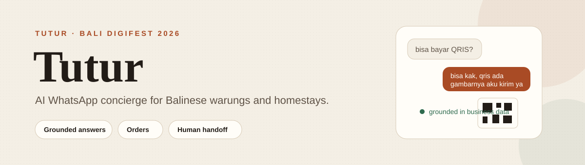
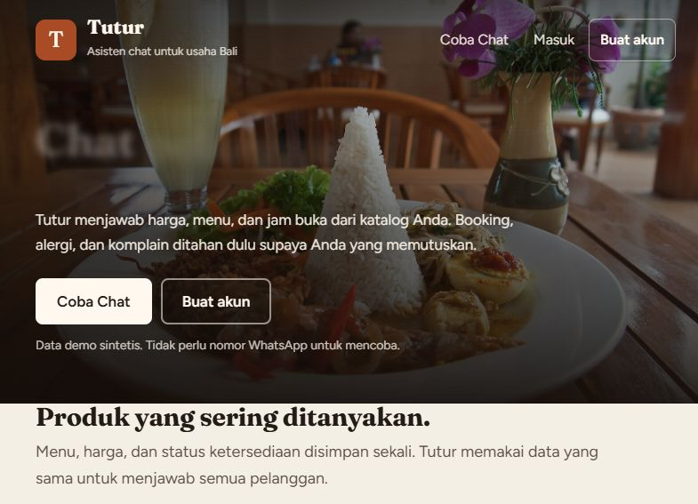
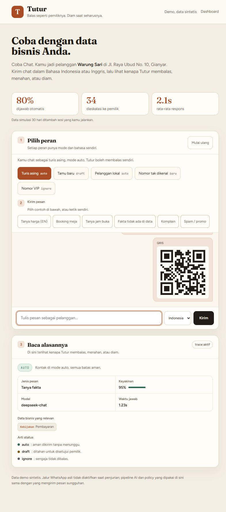
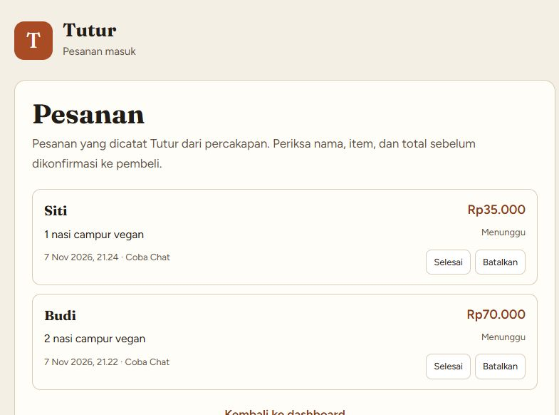
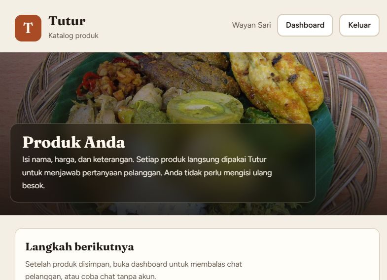

<div align="center">
  

  <p>
    <a href="https://github.com/CheztaGenZ/Tutur-Umkm-Assistant/actions/workflows/test.yml"></a>
    <a href="LICENSE"></a>
    
    
    
  </p>

  <p>
    <a href="https://tuturku.biz.id/coba"><strong>Live demo</strong></a> ·
    <a href="docs/ARCHITECTURE.md">Architecture</a> ·
    <a href="docs/eval-results.md">Evaluation</a> ·
    <a href="docs/DEPLOY.md">Deployment</a> ·
    <a href="README.id.md">Bahasa Indonesia</a>
  </p>
</div>

Tutur is a WhatsApp concierge for small Balinese businesses. It answers customer questions from the owner's own menu, hours, location, and payment data, writes incoming orders into a dashboard, and stops before booking, allergy, complaint, or price-sensitive messages reach the customer without the owner's approval.

The project was built for **Bali DigiFest 2026, AI Web Innovation Challenge**, category Mahasiswa/Umum. The submitted version is tagged `v1.0-submission`.

## The problem

A warung or homestay in Ubud gets messages in Indonesian and English while the owner is cooking, driving, or asleep. Quick replies cannot answer "do you have vegan options" or "can I pay with QRIS". A general chatbot invents prices and confirms tables that do not exist.

Tutur keeps the answer inside the business data. When the data is missing, it says it will check with the owner.

## Inside the product

<table>
  <tr>
    <td width="50%">
      
      <br /><sub>Public landing page. The judge demo needs no account.</sub>
    </td>
    <td width="50%">
      
      <br /><sub>Coba Chat: grounded QRIS reply, payment image, and the decision trace.</sub>
    </td>
  </tr>
  <tr>
    <td width="50%">
      
      <br /><sub>Orders captured from chat, with status controls for the owner.</sub>
    </td>
    <td width="50%">
      
      <br /><sub>One product catalog feeds the website and the AI knowledge base.</sub>
    </td>
  </tr>
</table>

## What it does

| Capability | Behavior |
|---|---|
| Grounded answers | Prices, hours, menu, location, and payment details come from the owner's knowledge base. Missing facts become a draft, never a guess. |
| Owner voice | The style engine learns message length, casing, slang, and emoji habits from an exported chat. |
| Order capture | When a customer names items, Tutur writes the order to `/pesanan` with the customer name, items, and total. The owner can mark it done or cancelled. |
| Payment delivery | The owner sets cash, QRIS, and bank transfer. A QRIS question returns the owner's QR image; a transfer question returns the saved bank details. |
| Human handoff | Booking, order, complaint, and allergy messages become drafts. Spam is ignored. VIP contacts are never auto-replied. |
| Decision trace | Every Coba Chat reply shows the policy verdict, intent, confidence, cited business data, model, and latency. |
| Multi-account workspace | Email/password, Google, and Facebook sign-in. Each account has its own business profile, catalog, knowledge, orders, and AI provider settings. |
| Account AI keys | Each signed-in account saves its own provider key in Setting. The server key is used only for the public demo and admin access. |
| Account profile | Owners can change their display name and password from `/profil-akun`. Business details stay on `/profil-usaha`. |

## How it works

```text
Customer message
      |
      v
Intent and risk checks  ->  spam: ignore
      |
      v
Knowledge retrieval (SQLite)
      |
      v
AI generation (OpenAI-compatible)
      |
      v
Policy gate  ->  auto send / draft / ignore
      |
      +--> WhatsApp reply, QRIS image, order record
      |
      +--> Dashboard draft queue and decision trace
```

The same `generateReply` and `decide` functions run behind the WhatsApp transport and behind Coba Chat. The web demo is not a mock.

## AI implementation

| Part | Implementation |
|---|---|
| Retrieval | Query tokens are matched against knowledge titles, keywords, and bodies. The top three rows become the only allowed source of facts. |
| Generation | OpenAI-compatible chat completion. Default is DeepSeek `deepseek-chat`. The settings page also supports OpenAI, Gemini, OpenRouter, Groq, and Ollama. |
| Intent guard | The model returns `intent` and `needs_owner`. A deterministic keyword guard also catches booking, order, and complaint messages if the model mislabels them. |
| Policy | `src/policy.js` chooses auto, draft, or ignore. Escalation wins over auto. Spam is ignored even for a new contact. |
| Language | Indonesian and English replies are enforced from the customer's language. |
| Vision and voice | Optional image understanding and local transcription for voice notes. |

### Evaluation

`npm run eval` runs 28 questions twice: once without the knowledge base and once with retrieval. The automated keyword check writes its result to [docs/eval-results.md](docs/eval-results.md).

| Metric | Without knowledge base | Tutur |
|---|---:|---:|
| Correct answers | 13/28 | 28/28 |
| Invented prices on missing facts | not measured | 0 |

These are results from the included test set, not a human panel. The method and limitations are documented in the result file.

## Stack

| Layer | Choice |
|---|---|
| Runtime | Node.js 22 or newer |
| HTTP | Express 4 |
| Database | SQLite through `node:sqlite` |
| AI | OpenAI-compatible endpoint, DeepSeek by default |
| Frontend | Plain HTML, CSS, and ES modules. No build step. |
| WhatsApp | Baileys, disabled during judging |
| Hosting | Any Node host with a persistent disk |

## Quick start

```bash
git clone https://github.com/CheztaGenZ/Tutur-Umkm-Assistant.git
cd Tutur-Umkm-Assistant
cp .env.example .env
# set AI_API_KEY and AI_MODEL in .env
npm install
npm start
```

Open `http://localhost:3000` for the dashboard and `http://localhost:3000/coba` for the no-login demo.

### Demo mode

```bash
DEMO_MODE=1 ADMIN_TOKEN=change-me npm start
```

Demo mode seeds the Sari Kitchen dataset, turns WhatsApp off, and keeps Coba Chat public with rate limiting. Dashboard APIs then accept the `ADMIN_TOKEN` value.

Windows users can run `copy .env.example .env` instead of `cp`.

### Configuration

| Variable | Purpose |
|---|---|
| `AI_API_KEY` | Provider key. Required for AI replies. |
| `AI_BASE_URL` | OpenAI-compatible base URL. |
| `AI_MODEL` | Text model name. |
| `PORT` | HTTP port, default `3000`. |
| `DATA_DIR` | SQLite, uploads, and session data. Needs a persistent disk. |
| `BIND_HOST` | Default `127.0.0.1`. Change only behind a trusted proxy. |
| `DEMO_MODE` | `1` seeds the demo dataset and disables WhatsApp. |
| `ADMIN_TOKEN` | Dashboard token for demo deployments. |

The full list is in [docs/CONFIGURATION.md](docs/CONFIGURATION.md).

## Tests

```bash
npm test
```

The suite covers the handler, status scheduling, settings, security, prompt grounding, playlist decisions, public API, demo seed, auth, products, and account isolation. It uses a temporary database and a fake WhatsApp client, so no WhatsApp account or real API key is needed.

Additional checks:

```bash
node scripts/security.test.mjs        # 42 security checks
node scripts/prompt-grounding.test.mjs
npm run eval                          # needs a live AI key
```

CI runs `npm test` on every push and pull request through [.github/workflows/test.yml](.github/workflows/test.yml).

## Project layout

```text
src/
  ai/           prompt, model client, vision, memory, usage
  wa/           Baileys transport, handler, status worker
  ingest/       chat export import and style extraction
  demo/         Sari Kitchen seed data and personas
  server.js     Express routes, auth, dashboard, public demo
  db.js         SQLite schema and data access
  policy.js     auto, draft, and ignore decisions
public/         landing page, dashboard, catalog, orders, Coba Chat
docs/           architecture, configuration, deployment, evaluation
scripts/        tests, evaluation, import, and diagnostic CLIs
evals/          grounded answer question set
proposal/       Bali DigiFest submission documents
```

## Documentation

| Document | Contents |
|---|---|
| [Architecture](docs/ARCHITECTURE.md) | Request flow, modules, and data model |
| [How it works](docs/HOW_IT_WORKS.md) | Retrieval, policy, and reply pipeline |
| [Configuration](docs/CONFIGURATION.md) | Environment variables and provider setup |
| [Deployment](docs/DEPLOY.md) | cPanel, Render, OAuth, and persistent disk |
| [Evaluation](docs/eval-results.md) | Dataset, method, and results |
| [Security](SECURITY.md) | Reporting and deployment boundaries |
| [Roadmap](docs/ROADMAP.md) | Known gaps and next work |

## Known limitations

- WhatsApp transport is disabled during judging to avoid account risk. Coba Chat exercises the same AI and policy code.
- One WhatsApp number belongs to one account per deployment. The first account that claims the connected number owns its chats, drafts, and replies. Other accounts keep their own business profile, catalog, knowledge, and orders, but cannot see or control that WhatsApp session.
- A signed-in account needs its own AI provider key in Setting before Coba Chat or WhatsApp replies work. The public demo and admin view use the server key.
- API keys are encrypted at rest with a key stored in `data/.app-secret`. Back up that file together with `app.db`, or saved keys cannot be decrypted.
- New WhatsApp contacts start in auto mode. Booking, order, complaint, allergy, spam, and VIP rules still block or hold risky messages.
- Chat history and style training still share one workspace. Business profiles, catalogs, knowledge, and orders are isolated per account.
- Retrieval is keyword based. A larger catalog will need embeddings or a search index.
- SQLite fits a single-tenant deployment. Multi-tenant SaaS would need Postgres.
- The evaluation set has 28 questions and uses keyword scoring. It is a signal, not a benchmark.
- There is no real customer pilot yet. Impact figures on Coba Chat combine a 30-day simulation with live session data.

## Background and disclosure

Tutur builds on the author's earlier WhatsApp auto-reply project. The competition work, pre-existing components, and AI assistance are disclosed in [PRE-EXISTING.md](PRE-EXISTING.md) and [AI-TECHNOLOGY-DISCLOSURE.md](AI-TECHNOLOGY-DISCLOSURE.md).

## Author

Chesta Adabi Naufal. Built for Bali DigiFest 2026, AI Web Innovation Challenge.

## License

MIT. See [LICENSE](LICENSE).

## Photo credits

Landing photo: "Nasi campur as art, Ubud, Indonesia" by Vyacheslav Argenberg, CC BY 4.0, via Wikimedia Commons. Gallery photos: Gunawan Kartapranata (CC BY-SA 3.0), Crisco 1492 (CC BY-SA 3.0), mararie (CC BY-SA 2.0), via Wikimedia Commons.

