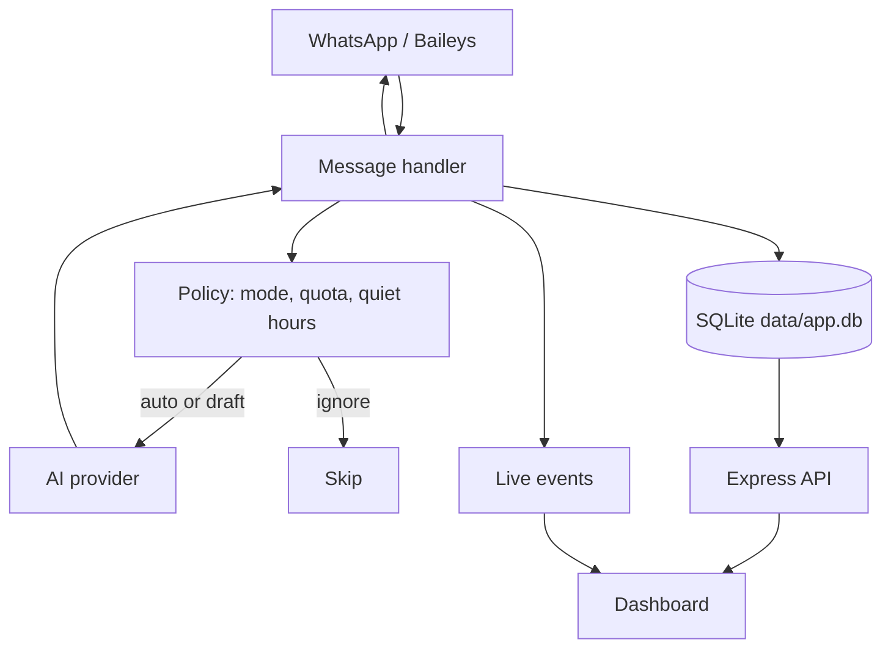
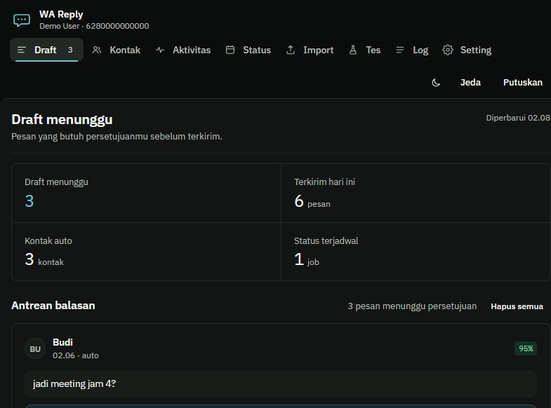
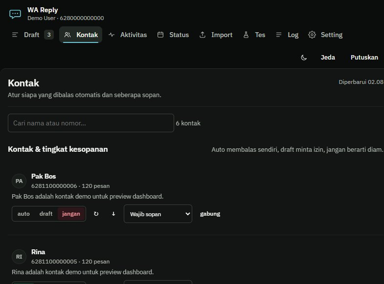
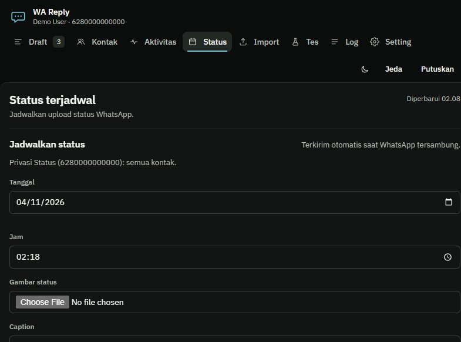
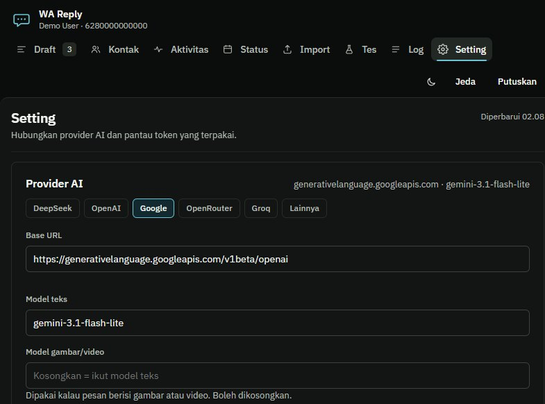
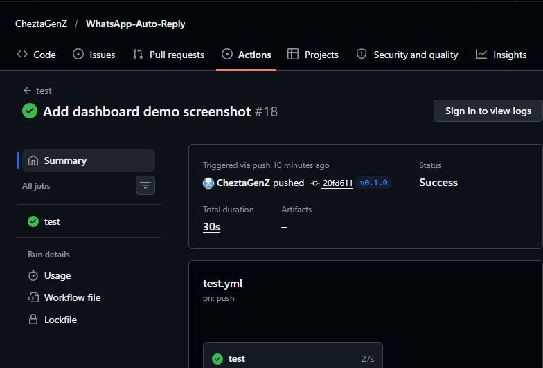

<p align="center">
  
</p>

<h1 align="center">WA Reply AI</h1>

<p align="center">
  A self-hosted WhatsApp auto-reply that learns how you type, decides when to reply,
  and keeps you in control with auto, draft, and ignore modes.
</p>

<p align="center">
  <a href="https://github.com/CheztaGenZ/WhatsApp-Auto-Reply/actions/workflows/test.yml"></a>
  <a href="LICENSE"></a>
  <a href="https://nodejs.org"></a>
  <a href="https://github.com/CheztaGenZ/WhatsApp-Auto-Reply"></a>
  <a href="https://github.com/CheztaGenZ/WhatsApp-Auto-Reply"></a>
  <a href="https://github.com/CheztaGenZ/WhatsApp-Auto-Reply"></a>
</p>

<p align="center">
  <a href="CONTRIBUTING.md"></a>
  <a href="https://github.com/CheztaGenZ/WhatsApp-Auto-Reply/stargazers"></a>
  <a href="https://github.com/CheztaGenZ/WhatsApp-Auto-Reply/network/members"></a>
</p>

> **Beta · self-hosted · single-user.** Not affiliated with WhatsApp or Meta.  
> Automating WhatsApp may violate its Terms of Service and can get a number banned. Use a spare number.

---

## Table of Contents

- [Why WA Reply AI?](#why-wa-reply-ai)
- [Features](#features)
- [How it works](#how-it-works)
- [Demo](#demo)
- [Quick start](#quick-start)
- [Configuration](#configuration)
- [Data and privacy](#data-and-privacy)
- [Security](#security)
- [Verification](#verification)
- [Documentation](#documentation)
- [Roadmap](#roadmap)
- [Contributing](#contributing)
- [License](#license)
- [Disclaimer](#disclaimer)

## Why WA Reply AI?

Most auto-replies feel like robots. WA Reply AI tries to sound like **you**:

- learns your message length, casing, punctuation, slang, and emoji habits from exported chats
- writes short, human-sounding replies instead of corporate paragraphs
- keeps sensitive chats in `draft` mode until you approve them
- respects quiet hours, rate limits, and per-contact cooldowns
- runs locally with SQLite, so your chats never go to a database provider

## Features

| Feature | What it does |
|---|---|
| **Per-contact modes** | `auto`, `draft`, or `ignore` for every chat |
| **Persona engine** | Style profile, relationship card, few-shot examples, memory |
| **Multi-provider AI** | Google Gemini, OpenRouter, DeepSeek, OpenAI-compatible, Ollama |
| **Vision** | Images and stickers are sent to a vision-capable model |
| **Voice notes** | Local Whisper transcription (or an online transcription endpoint) |
| **Status scheduling** | Schedule, post, revoke, and respect WhatsApp Status privacy |
| **Local dashboard** | Drafts, contacts, status, activity, token usage, live logs |
| **Safety rails** | Daily/hourly limits, quiet hours, per-contact gap, confidence threshold |
| **SQLite storage** | Zero database setup. No Postgres or Supabase required |
| **Import** | WhatsApp export as `.txt` or `.zip` |

## How it works



Read the full breakdown in [docs/ARCHITECTURE.md](docs/ARCHITECTURE.md) and the
step-by-step reply flow in [docs/HOW_IT_WORKS.md](docs/HOW_IT_WORKS.md).

## Demo

<p align="center">
  <a href="docs/assets/demo/demo.mp4">
    
  </a>
</p>

> Click the image to play the 21-second demo video. Demo data only. No real chats,
> names, or phone numbers. The video is a slideshow built from screenshots of a local
> demo instance and the CI success page.

<details>
<summary>More screenshots</summary>

| Contacts | Status |
|---|---|
|  |  |

| Settings | CI success |
|---|---|
|  |  |

</details>

## Quick start

Requires **Node.js 22+**.

```bash
git clone https://github.com/CheztaGenZ/WhatsApp-Auto-Reply.git
cd WhatsApp-Auto-Reply
npm ci
cp .env.example .env      # Windows: copy .env.example .env
# add AI_API_KEY and MY_NAME to .env
npm start
```

Open <http://localhost:3000> and scan the QR code:

**WhatsApp → Linked devices → Link a device**

The dashboard binds to `127.0.0.1` by default. To use it from a phone on the same
Wi-Fi, set `BIND_HOST=0.0.0.0` and read [Security](#security) first.

Detailed guide: [docs/INSTALL.md](docs/INSTALL.md).

## Configuration

Full reference: [docs/CONFIGURATION.md](docs/CONFIGURATION.md).

```env
# Google Gemini
AI_BASE_URL=https://generativelanguage.googleapis.com/v1beta/openai
AI_MODEL=gemini-3.1-flash-lite
AI_VISION_MODEL=
AI_THINKING=auto

# OpenRouter
# AI_BASE_URL=https://openrouter.ai/api/v1
# AI_MODEL=nvidia/nemotron-3-ultra-550b-a55b:free
# AI_VISION_MODEL=nvidia/nemotron-3-nano-omni-30b-a3b-reasoning:free
```

Leave `AI_VISION_MODEL` empty to use the text model for images and video.

## Data and privacy

Everything stays on your machine:

```text
data/app.db        SQLite database
data/auth/         WhatsApp session
data/status/       status images
.env               API keys and config
profile.md         persona profile
stickers/          sticker collection
```

Back up by stopping the bot and copying `data/`, `.env`, `profile.md`, and
`stickers/`. Do not copy `app.db` alone while the server is running; SQLite uses WAL.

> Dashboard screenshots are intentionally not included in this public repo to avoid
> exposing real chats, names, or phone numbers.

## Security

- Default bind: **127.0.0.1** (local PC only).
- LAN access is read-only for most data and write routes stay loopback-only.
- Never expose the port to the internet without VPN, a PIN, or an authenticated reverse proxy.
- Keep `.env`, `data/`, `profile.md`, and `import-inbox/` out of Git.
- Report vulnerabilities privately via [SECURITY.md](SECURITY.md).
- No cloud database, no analytics, no hidden telemetry. Read [docs/TRUST.md](docs/TRUST.md).

## Verification

- `npm test`: **47 handler + 11 status + 42 security + 31 smoke** checks
- GitHub Actions `test` workflow passes on `main`
- Demo screenshots use fake contacts and drafts, never real chats
- Details and honest limitations: [docs/VERIFICATION.md](docs/VERIFICATION.md)

## Documentation

- [Installation](docs/INSTALL.md)
- [How it works](docs/HOW_IT_WORKS.md)
- [Trust and transparency](docs/TRUST.md)
- [Verification](docs/VERIFICATION.md)
- [Architecture](docs/ARCHITECTURE.md)
- [Configuration](docs/CONFIGURATION.md)
- [FAQ](docs/FAQ.md)
- [Roadmap](docs/ROADMAP.md)
- [Security](SECURITY.md)
- [Contributing](CONTRIBUTING.md)

## Roadmap

- PIN/token authentication for LAN
- Authenticated reverse-proxy support
- Partial-bubble draft recovery
- Atomic cross-contact quota reservation
- Media redelivery race fix
- SSRF guard for provider testing
- Rate limits for read APIs, AI, and imports
- Video support

See [docs/ROADMAP.md](docs/ROADMAP.md) for details.

## Contributing

Issues and pull requests are welcome. Please read [CONTRIBUTING.md](CONTRIBUTING.md)
and [CODE_OF_CONDUCT.md](CODE_OF_CONDUCT.md) first. For security issues, follow
[SECURITY.md](SECURITY.md).

## License

[MIT](LICENSE) © 2026 Chesta Adabi Naufal.

## Disclaimer

This project is not affiliated with WhatsApp, Meta, Google, OpenRouter, or DeepSeek.
WhatsApp automation may violate their Terms of Service and can result in a ban.
Use at your own risk.

---

<p align="center">
  <a href="https://star-history.com/#CheztaGenZ/WhatsApp-Auto-Reply&Date">
    
  </a>
</p>
