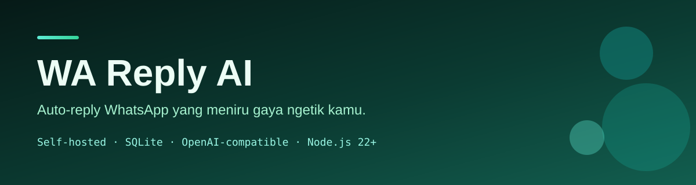

<p align="center">
  
</p>

<h1 align="center">WA Reply AI</h1>

<p align="center">
  Auto-reply WhatsApp yang mempelajari gaya ngetik kamu, dengan mode auto/draft/abaikan,
  dashboard lokal, SQLite, dan provider AI yang kompatibel OpenAI.
</p>

<p align="center">
  <a href="https://github.com/CheztaGenZ/WhatsApp-Auto-Reply/actions/workflows/test.yml"></a>
  <a href="LICENSE"></a>
  <a href="https://nodejs.org"></a>
  <a href="https://github.com/CheztaGenZ/WhatsApp-Auto-Reply"></a>
  <a href="https://github.com/CheztaGenZ/WhatsApp-Auto-Reply"></a>
  <a href="https://github.com/CheztaGenZ/WhatsApp-Auto-Reply"></a>
  <a href="https://github.com/CheztaGenZ/WhatsApp-Auto-Reply/stargazers"></a>
</p>

> **Status:** beta, self-hosted, satu pengguna. Bukan produk resmi WhatsApp. Risiko ban nomor tetap ada.

## Daftar Isi

- [Kenapa proyek ini ada](#kenapa-proyek-ini-ada)
- [Fitur](#fitur)
- [Arsitektur singkat](#arsitektur-singkat)
- [Quick start](#quick-start)
- [Konfigurasi](#konfigurasi)
- [Database](#database)
- [Keamanan](#keamanan)
- [Dokumentasi](#dokumentasi)
- [Kontribusi](#kontribusi)
- [Lisensi](#lisensi)
- [Disclaimer](#disclaimer)

## Kenapa proyek ini ada

Balas chat satu per satu itu melelahkan, tapi auto-reply generik terasa seperti robot.
WA Reply AI mencoba menyelesaikan dua hal itu:

1. **Meniru gaya ngetik kamu** dari export chat: panjang balasan, huruf kecil, singkatan,
   emoji, dan kosakata khas.
2. **Tidak asal balas.** Setiap kontak punya mode `auto`, `draft`, atau `jangan`, plus
   pagar anti-ban seperti kuota, jeda per kontak, jam tenang, dan ambang keyakinan AI.

## Fitur

- **Mode per kontak:** `auto`, `draft`, `jangan`.
- **Persona dari chat asli:** analisis gaya, contoh few-shot, relationship card, memori.
- **Dashboard lokal:** draft, kontak, status, aktivitas, token AI, log live (SSE).
- **Multi-provider AI:** Google Gemini, OpenRouter, DeepSeek, OpenAI-compatible, Ollama.
- **Media:** gambar dan stiker dikirim ke model vision; pesan suara ditranskrip.
- **Status WhatsApp:** jadwalkan, kirim, tarik/revoke, hormati privasi Status.
- **Keamanan dasar:** CSRF guard, Host allowlist, CSP, LAN read-only, loopback-only writes.
- **SQLite lokal:** tanpa Postgres/Supabase, tanpa biaya database.
- **Import:** export WhatsApp `.txt` atau `.zip`.

## Arsitektur singkat

```text
WhatsApp (Baileys)
        │
        ▼
Message Handler ──► Policy (mode, kuota, jam tenang)
        │                    │
        │                    ▼
        │              AI Provider (OpenAI-compatible)
        │                    │
        ▼                    ▼
SQLite (data/app.db) ◄── Draft / Sent / Usage
        │
        ▼
Express Dashboard + SSE ──► Browser (PC / LAN read-only)
```

Detail: [docs/ARCHITECTURE.md](docs/ARCHITECTURE.md)

## Quick start

Butuh **Node.js 22+**.

```bash
git clone https://github.com/CheztaGenZ/WhatsApp-Auto-Reply.git
cd WhatsApp-Auto-Reply
npm ci
cp .env.example .env      # Windows: copy .env.example .env
# isi AI_API_KEY dan MY_NAME di .env
npm start
```

Buka <http://localhost:3000>, lalu scan QR:
**WhatsApp → Perangkat tertaut → Tautkan perangkat**.

Default dashboard hanya terbuka di PC (`BIND_HOST=127.0.0.1`). Untuk membuka dari HP
di Wi-Fi yang sama, ubah ke `BIND_HOST=0.0.0.0` dan baca [Keamanan](#keamanan).

## Konfigurasi

Lihat tabel lengkap di [docs/CONFIGURATION.md](docs/CONFIGURATION.md).

Contoh provider:

```env
# Google Gemini
AI_BASE_URL=https://generativelanguage.googleapis.com/v1beta/openai
AI_MODEL=gemini-3.1-flash-lite
AI_VISION_MODEL=
AI_THINKING=auto

# OpenRouter
# AI_BASE_URL=https://openrouter.ai/api/v1
# AI_MODEL=nvidia/nemotron-3-ultra-550b-a55b:free
# AI_VISION_MODEL=nvidia/nemotron-3-nano-omni-30b-a3b-reasoning:free
```

`AI_VISION_MODEL` kosong berarti gambar/video memakai model teks yang sama.
`AI_THINKING=off` disarankan untuk DeepSeek; `auto` untuk provider lain.

## Database

Database-nya **SQLite lokal** di `data/app.db`, dibuat otomatis saat pertama jalan.
Tidak perlu Postgres, Supabase, atau server database eksternal.

Yang perlu dibackup:

```text
data/app.db          + data/app.db-wal + data/app.db-shm
data/auth/           sesi WhatsApp
.env                 API key dan konfigurasi
profile.md           profil persona
stickers/            stiker
```

Cara aman: stop bot, copy seluruh folder `data/`, lalu copy `.env` dan `profile.md`.
Jangan copy `app.db` sendirian saat server hidup karena ada WAL.

## Keamanan

- Default bind **127.0.0.1**; jangan buka ke internet tanpa VPN/PIN/reverse proxy ber-auth.
- Semua aksi tulis hanya dari PC (loopback); LAN read-only.
- `.env`, `data/`, `profile.md`, dan `import-inbox/` tidak boleh di-commit.
- API key tidak pernah ditampilkan penuh di dashboard.
- Laporkan masalah keamanan lewat [SECURITY.md](SECURITY.md), bukan issue publik.

> **Peringatan:** WhatsApp Web tidak resmi. Gunakan nomor cadangan dan pahami risiko ban.

## Dokumentasi

- [Arsitektur](docs/ARCHITECTURE.md)
- [Konfigurasi](docs/CONFIGURATION.md)
- [FAQ](docs/FAQ.md)
- [Roadmap](docs/ROADMAP.md)
- [Keamanan](SECURITY.md)
- [Kontribusi](CONTRIBUTING.md)

## Kontribusi

PR dan issue terbuka. Baca [CONTRIBUTING.md](CONTRIBUTING.md) dan
[CODE_OF_CONDUCT.md](CODE_OF_CONDUCT.md) dulu. Untuk bug keamanan, ikuti
[SECURITY.md](SECURITY.md).

## Lisensi

[MIT](LICENSE) © 2026 Chesta Adabi Naufal.

## Disclaimer

Proyek ini tidak berafiliasi dengan WhatsApp, Meta, Google, OpenRouter, atau DeepSeek.
Penggunaan otomasi WhatsApp dapat melanggar ketentuan layanan dan berisiko banned.
Gunakan dengan tanggung jawab sendiri.
