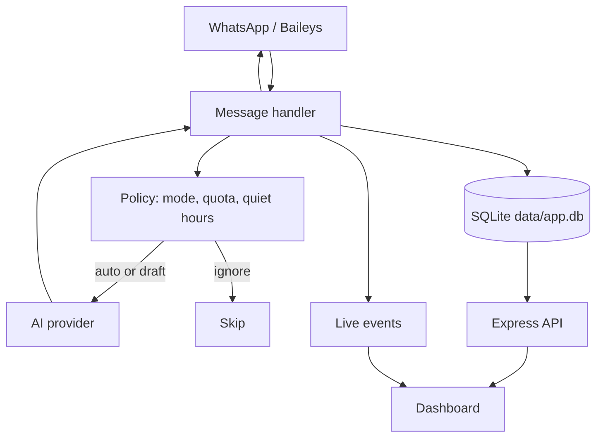

# Architecture

## Main flow



## Components

| Component | File | Responsibility |
|---|---|---|
| WhatsApp client | `src/wa/client.js` | Baileys socket, QR, text/media/status sending, privacy sync |
| Handler | `src/wa/handler.js` | Receive messages, call AI, choose auto/draft/ignore |
| Policy | `src/policy.js` | Quotas, cooldowns, quiet hours, VIP, contact mode |
| AI client | `src/ai/client.js` | OpenAI-compatible requests, fallbacks, usage |
| Prompt | `src/ai/prompt.js` | Persona, relationship card, few-shot, output rules |
| Database | `src/db.js` | SQLite schema and helpers |
| Server | `src/server.js` | Express API, static dashboard, SSE, security middleware |
| Dashboard | `public/` | Framework-free UI with strict CSP |
| Status worker | `src/wa/statusWorker.js` | Scheduled statuses, atomic claims, quota |
| Import | `src/ingest/` | Export parsing, style analysis, seeding, ZIP auto-import |

## Data

```text
data/
  app.db        main SQLite database (WAL)
  auth/         multi-file WhatsApp session
  status/       status images
```

Main tables: `contacts`, `messages`, `drafts`, `examples`, `wa_contacts`,
`group_samples`, `activities`, `status_jobs`, `status_send_log`, `ai_usage`, `kv`.

## Trust boundaries

- PC dashboard: read and write.
- LAN dashboard: read-only for most data, with sensitive fields redacted.
- WhatsApp: untrusted input; message content reaches prompts and the dashboard.
- AI provider: receives conversation snippets; do not send data that must not leave your machine.
- `.env` and `data/` are sensitive and must never be committed.

## Why SQLite

This is a single-user, single-machine app. SQLite gives:

- zero setup and zero database cost
- local data, no cloud database provider
- fast queries for thousands of messages
- backup by copying a folder

Postgres or Supabase only makes sense if the project becomes multi-user/SaaS or runs
across multiple instances. A WhatsApp bot still needs a long-lived process, so the
database is only one part of that architecture.
