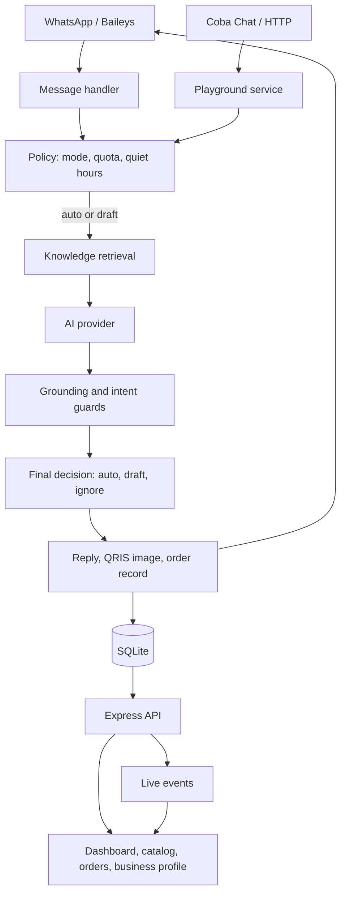

# Architecture

## Main flow



## Components

| Component | File | Responsibility |
|---|---|---|
| WhatsApp client | `src/wa/client.js` | Baileys socket, QR, text/media/status sending, privacy sync |
| Handler | `src/wa/handler.js` | Receive messages, call AI, record orders, choose auto/draft/ignore |
| Policy | `src/policy.js` | Quotas, cooldowns, quiet hours, VIP, contact mode |
| AI client | `src/ai/client.js` | OpenAI-compatible requests, fallbacks, usage |
| Prompt | `src/ai/prompt.js` | Persona, relationship card, few-shot, grounding, output rules |
| Knowledge | `src/knowledge.js` | Token retrieval, scoring, prompt source block |
| Products | `src/products.js` | Catalog CRUD and knowledge sync |
| Playground | `src/playground.js` | Public Coba Chat, decision trace, order capture |
| Accounts | `src/auth.js`, `src/server.js` | Scrypt passwords, hashed sessions, OAuth, terms |
| Database | `src/db.js` | SQLite schema and data helpers |
| Server | `src/server.js` | Express API, pages, SSE, security middleware |
| Frontend | `public/` | Framework-free UI with strict CSP |
| Status worker | `src/wa/statusWorker.js` | Scheduled statuses, atomic claims, quota |
| Import | `src/ingest/` | Export parsing, style analysis, seeding, ZIP auto-import |

## Request lifecycle

1. A message arrives from WhatsApp or Coba Chat.
2. The handler loads the contact, recent messages, style, examples, and the owner's knowledge rows.
3. Retrieval picks the top three knowledge rows for the message.
4. The AI returns a reply, intent, confidence, cited sources, payment intent, and optional order fields.
5. Deterministic guards catch missing sources, risky intents, absence claims, and deferral phrases.
6. Policy decides between auto send, draft, and ignore.
7. Auto send writes the reply and any QRIS image. Orders are recorded for both auto and draft paths.
8. The dashboard, orders page, and SSE stream show the result.

## Data

```text
data/
  app.db        main SQLite database (WAL)
  uploads/      product images and QRIS images
  auth/         multi-file WhatsApp session
  status/       status images
```

Main tables: `users`, `sessions`, `business_profiles`, `products`, `orders`,
`contacts`, `messages`, `drafts`, `examples`, `knowledge`, `wa_contacts`,
`group_samples`, `activities`, `status_jobs`, `status_send_log`, `ai_usage`, `kv`.

Business profile, products, knowledge, and orders are scoped by `owner_id`.
Chat history and style training still use one workspace in this MVP.

## Trust boundaries

- PC dashboard: read and write.
- LAN dashboard: read-only for most data, with sensitive fields redacted.
- WhatsApp: untrusted input. Message content reaches prompts and the dashboard.
- Coba Chat: public and rate limited in demo mode.
- AI provider: receives conversation snippets. Do not send data that must not leave your machine.
- `.env` and `data/` are sensitive and must never be committed.

## Why SQLite

This is a single-tenant deployment. SQLite gives:

- zero setup and no database cost
- local data, no cloud database provider
- fast queries for thousands of messages
- backup by copying a folder

Postgres makes sense only for a multi-tenant SaaS or multiple app instances. A WhatsApp bot still needs a long-lived process, so the database is one part of the deployment.
