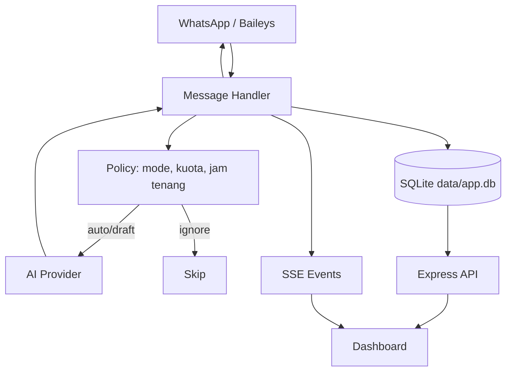

# Arsitektur

## Alur utama



## Komponen

| Komponen | File | Tugas |
|---|---|---|
| WhatsApp client | `src/wa/client.js` | Socket Baileys, QR, kirim teks/media/status, privacy sync |
| Handler | `src/wa/handler.js` | Terima pesan, panggil AI, pilih auto/draft/ignore |
| Policy | `src/policy.js` | Kuota, jeda, jam tenang, VIP, mode kontak |
| AI client | `src/ai/client.js` | OpenAI-compatible request, fallback, usage |
| Prompt | `src/ai/prompt.js` | Persona, relationship, few-shot, aturan output |
| Database | `src/db.js` | SQLite schema + helper |
| Server | `src/server.js` | Express API, static dashboard, SSE, security middleware |
| Dashboard | `public/` | UI tanpa framework, CSP strict |
| Status worker | `src/wa/statusWorker.js` | Kirim status terjadwal, klaim atomik, kuota |
| Import | `src/ingest/` | Parse export, gaya, seed, auto-import ZIP |

## Data

```text
data/
  app.db        SQLite utama (WAL)
  auth/         sesi WhatsApp multi-file
  status/       gambar status
```

Tabel utama: `contacts`, `messages`, `drafts`, `examples`, `wa_contacts`,
`group_samples`, `activities`, `status_jobs`, `status_send_log`, `ai_usage`, `kv`.

## Batas kepercayaan

- Dashboard PC: bisa baca dan tulis.
- Dashboard LAN: read-only, dengan redaksi data sensitif.
- WhatsApp: sumber pesan tidak tepercaya; konten masuk ke prompt dan dashboard.
- AI provider: menerima potongan percakapan; jangan kirim data yang tidak boleh keluar.
- `.env` dan `data/` adalah data sensitif; jangan pernah di-commit.

## Kenapa SQLite

Proyek ini single-user dan berjalan di satu mesin. SQLite memberi:

- nol setup dan nol biaya
- data lokal, tidak keluar ke cloud
- query cukup cepat untuk ribuan pesan
- backup dengan copy folder

Postgres/Supabase baru relevan kalau proyek menjadi multi-user/SaaS atau berjalan di
banyak instance. Bot WhatsApp tetap butuh proses long-lived, jadi bukan sekadar database.
